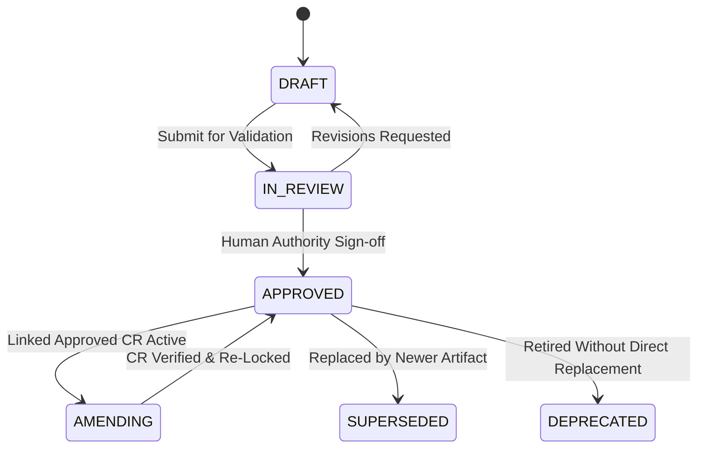
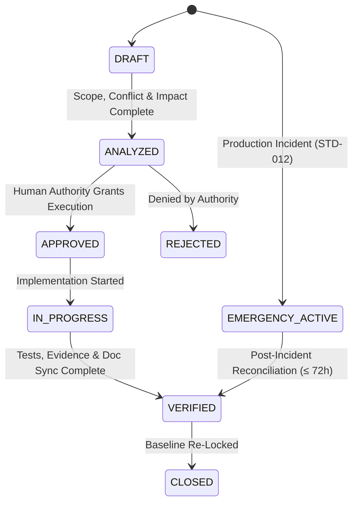

# GLOSSARY, IDENTIFIER GRAMMAR & NORMATIVE STATUS MODEL

## 1. NORMATIVE REQUIREMENT KEYWORDS (RFC 2119 / RFC 8174)

The uppercase key words below carry exact normative meaning across all AI-SDGS standards, policies, and validators. Lowercase occurrences (`must`, `should`, `may`) carry ordinary English meaning only and are non-normative.

| Keyword | Synonyms Permitted | Normative Meaning | `aisdgs validate` Default Behavior | `aisdgs validate --strict` Behavior |
| :--- | :--- | :--- | :--- | :--- |
| **`MUST`** | `REQUIRED`, `SHALL` | Absolute requirement of the standard within applicable Adoption Tiers. Violation is non-compliant unless covered by an active, approved `EXC-*` waiver (if waivable). | **ERROR** (`Exit Code 1`) | **ERROR** (`Exit Code 1`) |
| **`MUST NOT`** | `SHALL NOT` | Absolute prohibition within applicable Adoption Tiers. | **ERROR** (`Exit Code 1`) | **ERROR** (`Exit Code 1`) |
| **`SHOULD`** | `RECOMMENDED` | Strong engineering expectation. Deviation is permissible when valid technical reasons exist and trade-offs are understood/recorded. | **WARNING** (`Exit Code 0`) | **ERROR** (`Exit Code 1` unless justified) |
| **`SHOULD NOT`** | `NOT RECOMMENDED` | Strong engineering caution against an action unless justified by specific project constraints. | **WARNING** (`Exit Code 0`) | **ERROR** (`Exit Code 1` unless justified) |
| **`MAY`** | `OPTIONAL` | Truly discretionary capability; projects or tools may include or omit it without justification. | **INFO / PASS** (`Exit Code 0`) | **INFO / PASS** (`Exit Code 0`) |

Every normative rule in `STD-001`..`STD-012` MUST also carry a waivability tag:
- **`[NON-WAIVABLE]`** — Constitutional invariant; cannot be exempted by `EXC-*` under any Adoption Tier.
- **`[WAIVABLE]`** — Eligible for controlled, time-bounded exemption under `STD-002`.

---

## 2. CANONICAL IDENTIFIER GRAMMAR

To enable fast, regex-enforceable `L2-Deterministic` graph validation without fragile natural-language parsing, all governed entities MUST conform to the following identifier grammar:

| Entity Type | Canonical Regex Pattern | Example(s) | Design Rationale |
| :--- | :--- | :--- | :--- |
| **Universal Standard** | `^STD-(0[0-9]{2}|[1-9][0-9]{2})$` | `STD-001`, `STD-012` | Fixed 3-digit zero-padded standard IDs. |
| **Normative Standard Rule** | `^STD-[0-9]{3}-R[0-9]{2}$` | `STD-006-R04`, `STD-011-R01` | Allows pinpointing exact rules in CLI error messages and `EXC-*` waivers. |
| **Project Requirement** | `^REQ-(FUNC|NFUNC|SEC|DATA|INT)-[0-9]{3,4}$` | `REQ-FUNC-001`, `REQ-SEC-014` | Encodes requirement domain directly while keeping IDs compact. |
| **Architecture Decision Record** | `^ADR-[0-9]{3,4}$` | `ADR-001`, `ADR-0012` | Matches standard ADR tooling conventions. |
| **Change Request** | `^CR-[0-9]{4}$` | `CR-0001`, `CR-0042` | Track (`FAST` \| `FULL` \| `EMERGENCY`) is stored in YAML frontmatter so promoting a `FAST` CR to `FULL` **preserves its ID and existing links**. |
| **Governance Exception / Waiver** | `^EXC-[0-9]{4}$` | `EXC-0001` | Tracks temporary or permanent waivers with expiration dates (`STD-002`). |
| **Risk Register Item** | `^RISK-[0-9]{3,4}$` | `RISK-001` | Links identified threats to mitigating `REQ-*`, `ADR-*`, or `CR-*` artifacts. |

---

## 3. CANONICAL LIFECYCLE & STATUS STATE MACHINES

### 3.1 Normative & Baseline Document Status (`doc_status`)
Applies to `STD-*`, `PROJECT-CONSTITUTION.md`, `REQ-*` specs, `ADR-*`, and contract specifications:

- **`DRAFT`** — Work in progress; NOT authorized as an implementation baseline (`TIER-2`/`TIER-3` block feature execution against `DRAFT`-only specs).
- **`IN_REVIEW`** — Structurally valid (`L2` passing), awaiting Human Authority approval.
- **`APPROVED`** — Authoritative Single Source of Truth; protected against unapproved mutation.
- **`AMENDING`** — Controlled transitional state while an `APPROVED` Change Request updates the artifact prior to re-locking.
- **`SUPERSEDED`** — Replaced by another artifact (`superseded_by: <ID>` required in frontmatter).
- **`DEPRECATED`** — Retired capability retained for historical traceability only.

### 3.2 Project Baseline State (`baseline_state`)
Recorded in `governance/PROJECT-BASELINE.md`:
- **`UNINITIALIZED`** — Repository initialized (`aisdgs init`), baseline not yet established.
- **`ANCHORED`** — Brownfield initial safety lock established (protected globs, constitution, and known invariants locked while legacy modules undergo progressive baselining).
- **`LOCKED`** — Full baseline verified and SHA-256 artifact digests match working repository state.
- **`DRIFT_DETECTED`** — One or more locked baseline artifacts or protected paths differ from recorded hashes without an authorized active CR (`Exit Code 1` on `baseline verify`).

### 3.3 Change Request Lifecycle Status (`cr_status`)
Applies to `changes/records/CR-XXXX.md`:

### 3.4 Implementation & Claim Maturity States (`claim_state`)
Used in AI agent reporting (`STD-011`) and verification records (`STD-009`):
1. **`PROPOSED`** — Analyzed or designed only; neither approved nor coded.
2. **`APPROVED`** — Authorized specification or Change Request; code not yet complete.
3. **`IMPLEMENTED`** — Code or artifact written to disk, **not yet verified** by automated test/validation execution.
4. **`VERIFIED`** — Backed by reproducible execution output (passing test suite, `aisdgs validate` exit `0`, build artifact).

---

## 4. CANONICAL GLOSSARY

| Term | Normative Definition |
| :--- | :--- |
| **Adoption Profile** | Machine-readable manifest (`.aisdgs/adoption-profile.yaml`) declaring a project's selected Adoption Tier, onboarding pathway, applicable standards, and active waivers. |
| **Adoption Tier** | Risk-scaled governance profile (`LITE`, `STANDARD`, or `STRICT`) governing required artifacts, change rigor, and verification depth. |
| **Analysis Authority** | Permission to read project context, classify prompts, identify conflicts, assess impact, and draft proposed CRs/ADRs without mutating implementation or approved baselines. |
| **Anchor Baseline** | The initial partial baseline established in a **Brownfield** project locking non-negotiable boundaries, security rules, and protected paths before legacy modules are progressively documented. |
| **Authoritative Source** | The single designated artifact owning a given requirement, architectural decision, data contract, or policy (`Single Source of Truth`). |
| **Baseline** | A human-approved, versioned, and SHA-256 hash-manifested snapshot of project governance, requirements, architecture, and contract specifications (`PROJECT-BASELINE.md`). |
| **Baseline Drift** | Unauthorized or unrecorded divergence between the approved project baseline and actual source code, schemas, dependencies, or adapter configurations. |
| **Blast Radius** | The set of modules, public APIs, database schemas, external dependencies, security boundaries, and requirements affected by a proposed change. |
| **Brownfield Onboarding** | Adopting AI-SDGS within a pre-existing codebase that already contains production or legacy code and incomplete documentation. |
| **Change Request (CR)** | A structured governance record (`CR-XXXX`) authorizing, scoping, tracing, and verifying a baseline or protected-scope mutation (`FAST`, `FULL`, or `EMERGENCY` track). |
| **Context Budget** | Maximum permissible line or token size allocated to an AI instruction artifact to preserve LLM attention fidelity (`≤ 150 lines` for Tier 0 `AGENTS.md`). |
| **Deterministic Enforcement (`L2`)** | Automated compliance verification producing identical pass/fail results for identical inputs without relying on probabilistic LLM judgment. |
| **Execution Authority** | Permission to mutate source code, configurations, dependencies, schemas, or baseline documentation within an approved scope. |
| **Governance Exception (`EXC-*`)** | A documented, risk-assessed, human-approved, and time-bounded waiver exempting a project from a `[WAIVABLE]` normative requirement. |
| **Greenfield Adoption** | Applying AI-SDGS from project inception prior to writing production implementation code. |
| **Iterative Slice Baselining** | Establishing a system-wide foundation baseline upfront while approving feature-level requirements and contracts incrementally per vertical slice or milestone. |
| **Progressive Context Disclosure** | Loading minimal routing instructions into AI context initially (`Tier 0`) and fetching domain-specific operational policies (`Tier 1`) or reference standards (`Tier 2`) only when triggered. |
| **Prompt Classification** | Mandatory pre-action categorization of a user prompt into one of nine canonical request types to determine required governance controls. |
| **Protected Path** | Any file or glob declared in `.aisdgs/config.yaml` (e.g., `.aisdgs/**`, `governance/**`, DB migrations, auth modules, public OpenAPI/proto contracts) whose modification requires explicit authorization. |
| **Semantic Audit (`L3`)** | Structured human or AI-reviewer inspection evaluating whether code logic faithfully implements prose specifications using a deterministically assembled diff-and-context bundle. |
| **Standard Lockfile** | Read-only manifest (`.aisdgs/standard-lock.yaml`) recording the pinned AI-SDGS release version and SHA-256 digests of all installed Level 1 standard, policy, and schema files. |
