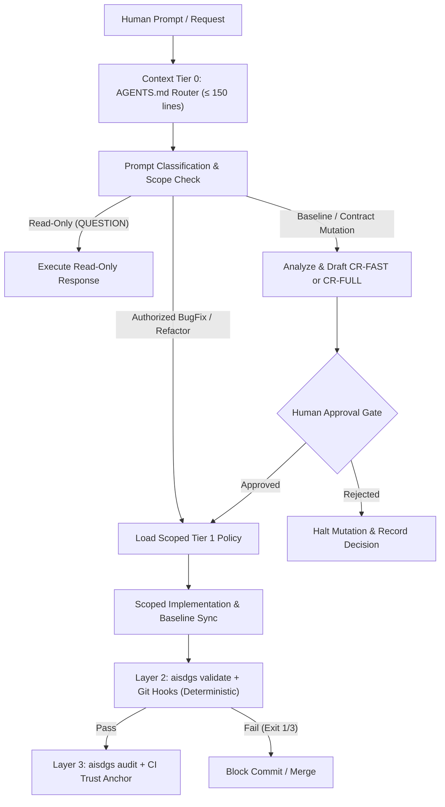

# AI-SDGS GOVERNANCE & PLATFORM ARCHITECTURE

## 1. ARCHITECTURAL OVERVIEW

**AI-SDGS** governs AI-assisted software engineering by interposing an explicit **Classification, Authorization, and Verification Control Plane** between natural-language prompts and repository mutations.

---

## 2. THREE-LEVEL GOVERNANCE HIERARCHY & PRECEDENCE LAW

AI-SDGS separates governance responsibilities into three decoupled levels governed by strict precedence rules:

| Level | Component | Authoritative Artifacts | Mutability in Target Project |
| :--- | :--- | :--- | :--- |
| **Level 1** | **Universal Standard (`AI-SDGS Core`)** | `STD-001` through `STD-012` + canonical JSON Schemas | **Immutable** (pinned via SHA-256 digests in `.aisdgs/standard-lock.yaml`). |
| **Level 2** | **Project Adoption Package** | `.aisdgs/config.yaml`, `.aisdgs/adoption-profile.yaml`, `governance/PROJECT-CONSTITUTION.md`, `governance/PROJECT-BASELINE.md`, `governance/EXCEPTIONS.md`, `docs/**`, `changes/**` | **Controlled Mutation** (governed by Adoption Tier, human approvals, and Change Requests). |
| **Level 3** | **Execution & Enforcement Layer** | `AGENTS.md`, tool adapters (`CLAUDE.md`, `GEMINI.md`, `.cursor/rules/*`), `.aisdgs/policies/*`, `aisdgs` CLI, Git/CI hooks | **Derived / Synchronized** from Level 1 + Level 2 via `aisdgs adapter sync` and enforced by `aisdgs validate`. |

### 2.1 Normative Precedence & Conflict Resolution Rules

When rules across levels interact, precedence is resolved deterministically:

1. **Non-Waivable Invariants (`IMMUTABLE`):** Core constitutional rules marked `[NON-WAIVABLE]` in `STD-001`..`STD-012` (specifically: *Human Final Approval Authority*, *Prompt-is-Not-Authorization*, *Evidence-Based Verification*, *Standard Lockfile Integrity*, and *Secret/Credential Non-Exposure*) **ALWAYS prevail**. Neither `PROJECT-CONSTITUTION.md` nor `EXCEPTIONS.md` may override them.
2. **Permissible Tightening (`STRICTER_ALLOWED`):** A Level 2 `PROJECT-CONSTITUTION.md` MAY promote any Level 1 `SHOULD` into a project-mandatory `MUST`, or restrict AI file/tool permissions more tightly than Tier defaults, without filing an exception.
3. **Controlled Tailoring & Waivers (`WAIVER_REQUIRED`):** A project MAY relax a waivable Level 1 `MUST` or `SHOULD` ONLY through an explicit, time-bounded `EXC-*` record in `governance/EXCEPTIONS.md` approved by the designated Human Authority (`STD-002`). Silent contradiction in `PROJECT-CONSTITUTION.md` or `AGENTS.md` is a compliance violation (`Exit Code 1`).
4. **Source-of-Truth Over Derived Adapters:** If a tool adapter (e.g., `CLAUDE.md`) diverges from `AGENTS.md` or `.aisdgs/config.yaml`, Level 2 configuration and Level 1 standards prevail, and `aisdgs validate` flags adapter drift requiring `aisdgs adapter sync`.

---

## 3. SOURCE REPOSITORY VS. TARGET PROJECT TOPOLOGY (`DEC-006`)

To eliminate self-referential path collisions during Milestone 2 development and E2E testing, the **AI-SDGS Authoritative Source Repository** (`ai-sdgs`) and any **Adopting Target Project** (`TARGET-PROJECT`) maintain strictly distinct layouts:

| `ai-sdgs` Source Monorepo Path | Purpose in Source Repo | Materialized Target Path in `TARGET-PROJECT/` | Materialization Mechanism |
| :--- | :--- | :--- | :--- |
| `standard/STD-001..012.md` | Authoritative normative standard source files | `.aisdgs/standard/STD-001..012.md` | Copied read-only & SHA-256 hashed into `.aisdgs/standard-lock.yaml` by `aisdgs init` / `update` |
| `schemas/*.schema.json` | Canonical JSON Schema (Draft 2020-12) definitions | `.aisdgs/schemas/*.schema.json` | Copied read-only & hashed into `standard-lock.yaml` |
| `policies/*.md` | Context Tier 1 operational playbooks for AI agents | `.aisdgs/policies/*.md` | Copied read-only & referenced by root `AGENTS.md` |
| `templates/<tier>/**` | Parameterized scaffolds (`lite`, `standard`, `strict`) & CR/ADR templates | `governance/*`, `docs/*`, `changes/*`, `.aisdgs/config.yaml` | Rendered once on `aisdgs init` or `aisdgs change create` (never overwritten silently on update) |
| `adapters/**` | Thin bridge templates for Claude, Gemini, Cursor, etc. | `AGENTS.md`, `CLAUDE.md`, `GEMINI.md`, `.cursor/rules/aisdgs.mdc` | Generated & verified via `aisdgs adapter sync` |
| `cli/` | Milestone 2 `aisdgs` executable source code & tests | Distributed as external `aisdgs` binary on system `PATH` / CI | Executed locally & in CI; never Vendored as raw source inside target projects |
| `docs/`, `quality/`, `BUILD-STATE.md` | AI-SDGS internal engineering specs & verification reports | *Not distributed to target projects* | Internal to `ai-sdgs` repository |

---

## 4. PROGRESSIVE 3-TIER CONTEXT ARCHITECTURE (`DEC-003`)

AI-SDGS treats LLM context window capacity and attention focus as scarce engineering resources:

### 4.1 Context Tier Allocations & Hard Budgets

| Context Tier | Target Artifact(s) | Loading Trigger | Hard Line Budget | Content Scope |
| :--- | :--- | :--- | :--- | :--- |
| **Tier 0 (Root Router)** | `AGENTS.md` | **Always loaded** at session start | **≤ 150 lines** | Project ID, Adoption Tier, Central Principle, 9-category Prompt Routing Table, Protected Path Globs, Approval Summary, exact pointers to Tier 1 policies. |
| **Tier 0b (Thin Bridges)** | `CLAUDE.md`, `GEMINI.md`, `.cursor/rules/aisdgs.mdc` | Loaded by vendor-specific agents that do not natively read `AGENTS.md` | **≤ 40 lines each** | Minimal tool-specific frontmatter + directive importing/deferring to `AGENTS.md` as single root router (zero duplicated rule tables). |
| **Tier 1 (Task Playbooks)** | `.aisdgs/policies/prompt-and-change.md`, `architecture-and-contracts.md`, `verification-and-evidence.md`, `brownfield-and-emergency.md` | **Conditionally loaded** only when prompt classification matches the playbook trigger | **≤ 250 lines each** | Step-by-step operational procedures, required `CR-FAST`/`CR-FULL` fields, checklists, and safe execution rules. |
| **Tier 2 (Reference & Schemas)** | `.aisdgs/standard/STD-001..012.md`, `.aisdgs/schemas/*.schema.json` | **On-demand lookup** for edge-case arbitration; **always enforced** by `aisdgs validate` | Unbounded (human/CLI reference; target 180–320 lines/STD) | Full normative `MUST`/`SHOULD` specifications, edge cases, and formal JSON Schemas. |

---

## 5. THREE-LAYER CONTROL & DEFENSE-IN-DEPTH ARCHITECTURE (`DEC-007`)

Every normative requirement in `STD-001`..`STD-012` maps to at least one of three complementary control layers:

### 5.1 Layer Breakdown

1. **`L1-Advisory` (Preventive Context Control):**
   - Instructs compliant AI agents *before* tool calls occur (prompt classification, scope discipline, refusal to smuggle features inside bug fixes).
   - *Limitation:* Cannot stop an adversarial prompt or hallucinating model on its own.
2. **`L2-Deterministic` (Hard Algorithmic Enforcement):**
   - Enforced offline in milliseconds/seconds by `aisdgs validate`, `aisdgs baseline verify`, and Git hooks.
   - Verifies: JSON Schema conformance, YAML frontmatter completeness, canonical ID syntax, broken cross-reference links (`REQ-*` ↔ `ADR-*` ↔ `CR-*`), Context Tier 0 line-budget compliance (`≤ 150` lines), SHA-256 integrity of `.aisdgs/standard-lock.yaml`, and unauthorized edits to protected paths without an active `APPROVED` Change Request.
3. **`L3-Semantic-Audit` (Structured Diff-vs-Baseline Review):**
   - Evaluates semantic alignment between source code implementation and prose requirements/ADRs across any programming language.
   - Enforced via `aisdgs audit`, which deterministically packages `git diff`, touched protected contracts, linked `REQ-*`/`ADR-*`/`CR-*` texts, and verification evidence into an auditable review bundle for human or independent Reviewer-Agent sign-off.

### 5.2 Defense-in-Depth Against Agent Self-Approval (`RISK-01`)

To prevent an autonomous local coding agent with write access from fabricating human approval (e.g., setting `approval_status: APPROVED` in a CR file or rewriting `PROJECT-BASELINE.md` hashes itself):

1. **Ring 1 — Agent Sandbox & Adapter Deny-Globs:** Adapter templates generate tool permission rules restricting autonomous writes to `.aisdgs/standard/**`, `.aisdgs/standard-lock.yaml`, `governance/PROJECT-CONSTITUTION.md`, and `governance/PROJECT-BASELINE.md` without explicit interactive user confirmation.
2. **Ring 2 — Local Git History & Lock Digest Inspection:** `aisdgs baseline verify` compares working-tree and staged changes against the last committed `PROJECT-BASELINE.md` digest and inspects whether `approval_status: APPROVED` or baseline lock mutations occurred inside the same uncommitted agent working session, emitting a high-visibility `SELF_APPROVAL_SUSPECTED` compliance failure unless explicitly locked via human CLI confirmation or committed baseline state.
3. **Ring 3 — Out-of-Band CI Trust Anchor (`TIER-2` & `TIER-3`):** In team and enterprise repositories, CI executes `aisdgs validate --strict` and `aisdgs baseline verify` against the target base branch (`main`/`trunk`), requiring platform-authenticated Pull Request review from designated Human Authorities (`CODEOWNERS` / branch protection) outside the AI agent's execution environment.
