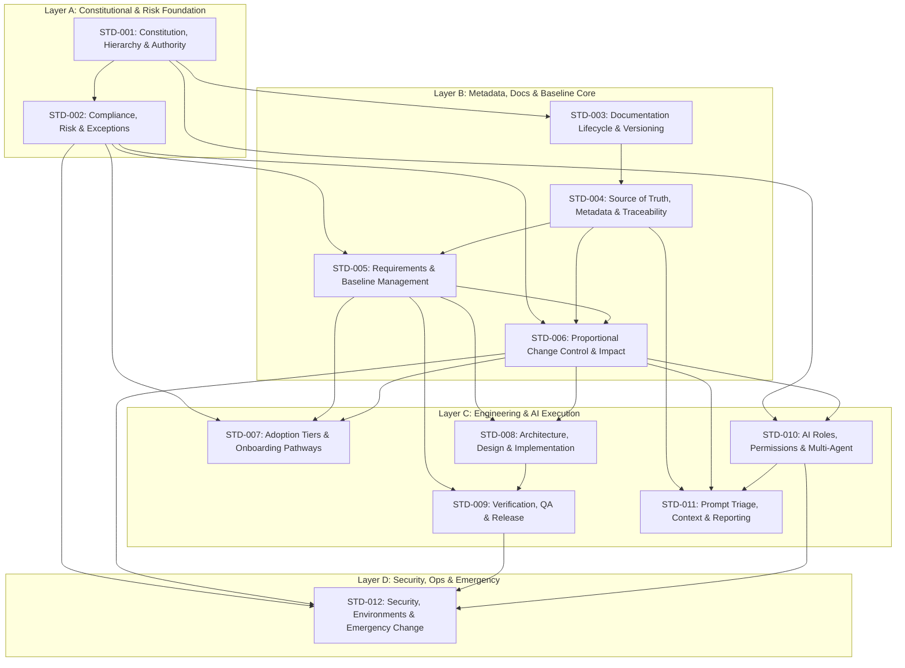

# STANDARD CATALOG & DEPENDENCY MATRIX

## 1. DIRECTED ACYCLIC DEPENDENCY GRAPH (ZERO CIRCULARITY)

To guarantee unambiguous interpretation and conflict-free validation, `STD-001` through `STD-012` form a strict **Directed Acyclic Graph (DAG)** across four architectural layers:



**DAG Invariant:** No lower-numbered foundational standard (`STD-001`..`004`) may normatively depend on a downstream lifecycle standard (`STD-007`..`012`). Cross-references from foundation to downstream standards are strictly informative (`See also`).

---

## 2. MASTER CATALOG SPECIFICATION MATRIX (`STD-001`..`STD-012`)

| ID | Domain | Official Standard Title | Authoring Batch | Upstream Normative Refs | Tier Applicability (`Lite` / `Std` / `Strict`) | Primary Control Mix | Mapped Phase 4 Schemas & Phase 6 CLI Commands |
| :--- | :--- | :--- | :--- | :--- | :--- | :--- | :--- |
| **`STD-001`** | Foundation | **Governance Constitution, Hierarchy & Authority Model** | Phase 2 (Batch A) | `RFC 2119`, `RFC 8174` | Core `MUST` across All Tiers | `L1` + `L2` | `config.schema.json`; `aisdgs status`, `validate` |
| **`STD-002`** | Foundation | **Compliance, Risk & Exception Governance** | Phase 2 (Batch A) | `STD-001` | Core `MUST` (Waiver expiry scales by Tier) | `L2` + `L3` | `adoption-profile.schema.json`, `exception.schema.json`; `validate`, `report` |
| **`STD-003`** | Documentation | **Documentation Lifecycle, Classification & Versioning** | Phase 2 (Batch A) | `STD-001` | Compact (`Lite`) / Full (`Std`, `Strict`) | `L1` + `L2` | `frontmatter.schema.json`; `validate` |
| **`STD-004`** | Documentation | **Source of Truth, Machine-Readable Metadata & Traceability** | Phase 2 (Batch A) | `STD-001`, `STD-003` | Compact IDs (`Lite`) / Full Graph (`Std`, `Strict`) | **`L2` (Primary)** | `frontmatter.schema.json`; `validate` (ID & link graph checker) |
| **`STD-005`** | Requirements | **Requirements Engineering & Baseline Management** | Phase 2 (Batch A) | `STD-002`, `STD-004` | Inline/Lite (`Lite`) / Discrete Locked (`Std`, `Strict`) | `L2` + `L3` | `baseline.schema.json`, `requirement.schema.json`; `baseline status|lock|diff|verify` |
| **`STD-006`** | Change Control | **Proportional Change Control, Impact Analysis & Conflict Resolution** | Phase 2 (Batch A) | `STD-002`, `STD-004`, `STD-005` | `CR-FAST` focus (`Lite`) / Dual-Track (`Std`, `Strict`) | `L1` + `L2` + `L3` | `change-request.schema.json`; `change create|status|verify` |
| **`STD-007`** | Software Lifecycle | **Project Adoption, Onboarding Modes & Lifecycle Governance** | Phase 3 (Batch B) | `STD-002`, `STD-005`, `STD-006` | All Tiers (`Greenfield`, `Brownfield`, `Iterative`) | `L1` + `L2` | `config.schema.json`, `standard-lock.schema.json`; `init`, `update`, `standard` |
| **`STD-008`** | Software Lifecycle | **Architecture, Technical Design & Implementation Governance** | Phase 3 (Batch B) | `STD-005`, `STD-006` | Guardrails (`Lite`) / Full ADR & Contract (`Std`, `Strict`) | `L1` + `L2` + `L3` | `adr.schema.json`; `validate`, `audit` |
| **`STD-009`** | Software Lifecycle | **Verification, Quality Assurance & Release Governance** | Phase 3 (Batch B) | `STD-005`, `STD-008` | Essential Evidence (`Lite`) / Strict Gates (`Std`, `Strict`) | `L2` + `L3` | `audit-report.schema.json`; `validate`, `audit`, `hooks`, `report` |
| **`STD-010`** | AI Governance | **AI Agent Roles, Permissions & Multi-Agent Coordination** | Phase 3 (Batch B) | `STD-001`, `STD-006` | Single-Agent Safe (`Lite`) / Multi-Role & Locks (`Std`, `Strict`) | `L1` + `L2` | `config.schema.json` (`protected_paths`, `agent_locks`); `adapter sync`, `validate` |
| **`STD-011`** | AI Governance | **Prompt Triage, Progressive Context Routing & Evidence Reporting** | Phase 3 (Batch B) | `STD-004`, `STD-006`, `STD-010` | **Mandatory (`≤150` line Tier 0 Router across All Tiers)** | `L1` + `L2` | `adapter sync`, `validate` (context line-budget check) |
| **`STD-012`** | Security & Ops | **Security, Environment, Operations & Emergency Governance** | Phase 3 (Batch B) | `STD-002`, `STD-006`, `STD-009`, `STD-010` | Secret/Env + Emergency Core (All Tiers); Ops Gates (`Std`, `Strict`) | `L1` + `L2` + `L3` | `change-request.schema.json` (`EMERGENCY` track); `validate`, `audit` |

---

## 3. STANDARD AUTHORING BLUEPRINT (FOR PHASES 2 & 3)

Every `STD-001`..`STD-012` file authored in Phase 2 and Phase 3 MUST strictly adhere to:

1. **YAML Frontmatter Contract:**
   ```yaml
   ---
   id: STD-XXX
   title: "<Official Standard Title>"
   version: 1.0.0
   status: DRAFT # Promoted to APPROVED upon Phase Gate sign-off
   domain: foundation | documentation | requirements-change | lifecycle | ai-governance | security-ops
   applies_to_tiers: [LITE, STANDARD, STRICT]
   normative_references: [ ... ] # Must obey Section 1 DAG
   last_updated: YYYY-MM-DD
   ---
   ```
2. **Mandatory 10-Section Normative Body:**
   - `1. Purpose & Governance Scope`
   - `2. Terms & Normative Definitions` (referencing `DOC-ARCH-002`, defining only standard-local terms)
   - `3. Roles & Authority Boundaries` (referencing `HUM-*` and `AI-*` from `DOC-ARCH-003`)
   - `4. Normative Requirements` (numbered `STD-XXX-R01`..`Rnn`, each tagged `[NON-WAIVABLE]` or `[WAIVABLE]`)
   - `5. Operational Procedures & Workflows`
   - `6. Proportional Tier Scaling Rules` (`LITE` vs. `STANDARD` vs. `STRICT`)
   - `7. Exceptions & Escalation Rules`
   - `8. Three-Layer Control Mapping Table` (`Rule ID` → `L1-Advisory` / `L2-Deterministic` / `L3-Semantic-Audit`)
   - `9. Verification Criteria & Required Evidence`
   - `10. Cross-References & Change History`
