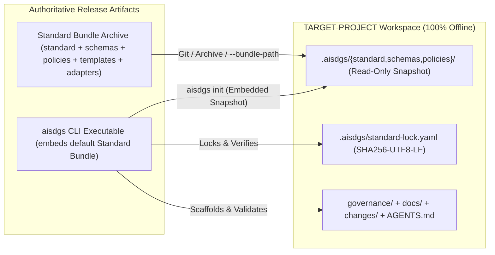

# PLATFORM & HYBRID DISTRIBUTION SPECIFICATION

## 1. HYBRID ARCHITECTURE OVERVIEW

AI-SDGS separates **Normative Content Distribution** (pure text Markdown + JSON Schemas) from **Executable Tooling Distribution** (`aisdgs` CLI binary), while embedding the default approved standard bundle directly inside each CLI release so `aisdgs init` and `aisdgs validate` operate **100% offline with zero network calls**.

---

## 2. DISTRIBUTION CHANNELS & PACKAGING CONTRACT

### 2.1 Channel A — Standalone Standard Release Bundle (`ai-sdgs-standard-vX.Y.Z.{tar.gz,zip}`)
- **Contents:** `standard/STD-001..012.md`, `schemas/*.schema.json`, `policies/*.md`, `templates/**`, `adapters/**`, and signed `RELEASE-MANIFEST.json` (listing `SHA256-UTF8-LF` digests of every file).
- **Use Cases:** Air-gapped enterprise networks, non-CLI manual inspection, custom internal forks/mirrors, and pinning older/newer standard bundles via `aisdgs init --bundle <archive-or-dir>`.
- **Zero Language Coupling:** Contains zero executable scripts, zero `package.json`, and zero runtime assumptions.

### 2.2 Channel B — `aisdgs` Standalone CLI Distribution
- **Primary Artifact:** Precompiled standalone cross-platform executables (`aisdgs-windows-x64.exe`, `aisdgs-linux-x64`, `aisdgs-linux-arm64`, `aisdgs-darwin-arm64`) embedding the matching `vX.Y.Z` Standard Bundle as read-only internal resources.
- **Secondary Convenience Wrappers (Optional):** GitHub Action / GitLab CI container wrapper and optional package-manager shims that invoke the standalone binary without injecting dependencies into the target project's build manifest.

---

## 3. VERSIONING, LOCKFILE INTEGRITY & SAFE UPGRADES (`STD-001-R05`, `STD-007-R07`)

### 3.1 Lockfile Generation & Integrity Verification
1. During `aisdgs init`, every Level 1 file written into `.aisdgs/standard/`, `.aisdgs/schemas/`, and `.aisdgs/policies/` has its bytes normalized (`\r\n` → `\n`, UTF-8 per `DEC-013`) and hashed with SHA-256.
2. `.aisdgs/standard-lock.yaml` records `standard_version`, `release_id`, `hash_normalization: SHA256-UTF8-LF`, `installed_at`, and the sorted `files` array.
3. Any local modification, deletion, or unrecorded extra file inside `.aisdgs/{standard,schemas,policies}/` triggers `INTEGRITY_COMPROMISED` (`Exit Code 3`).

### 3.2 Non-Destructive Upgrade & Rollback Protocol
1. **Compatibility Rules (SemVer):**
   - **`PATCH` (`1.0.x`):** Clarifications, typo fixes, bug fixes in validator logic; 100% schema-compatible with existing `.aisdgs/config.yaml` and `PROJECT-BASELINE.md`.
   - **`MINOR` (`1.x.0`):** Backward-compatible optional schema properties, new adapter targets, or new advisory guidance; existing projects remain `COMPLIANT` without rewriting baselines.
   - **`MAJOR` (`2.0.0`):** Normative requirement additions/changes or breaking schema updates; requires `aisdgs update plan` impact report and `CR-FULL` human sign-off (`STD-007-R07`).
2. **Write-Barrier Guarantee:** `aisdgs update` writes **ONLY** to `.aisdgs/{standard,schemas,policies}/` and `.aisdgs/standard-lock.yaml` (plus `AGENTS.md` / bridges when `--sync-adapters` is confirmed). It **MUST NEVER** touch `governance/**`, `docs/**`, `changes/**`, or `src/**`.
3. **Instant Rollback:** Because `.aisdgs/` is committed to the project's Git repository, rolling back a standard upgrade is a single deterministic `git revert` / `git checkout` restoring both the snapshot and lockfile atomically.

---

## 4. OPTIONAL CENTRAL PORTFOLIO TELEMETRY INTERFACE (NON-MANDATORY)

- Local CLI execution MUST default to **zero outbound network requests** (`telemetry: disabled`).
- Organizations wishing to aggregate multi-repository compliance posture MAY ingest the deterministic JSON output of `aisdgs report --format json` inside their existing CI pipelines (pushing JSON artifacts to internal dashboards without coupling local developer workflows to a central server).
